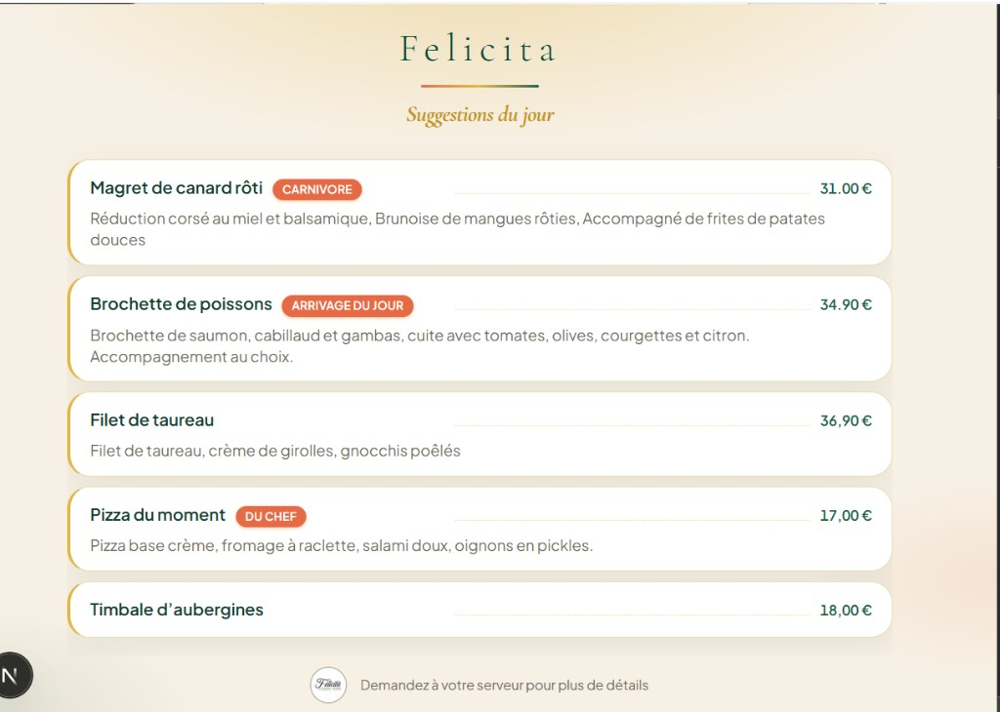
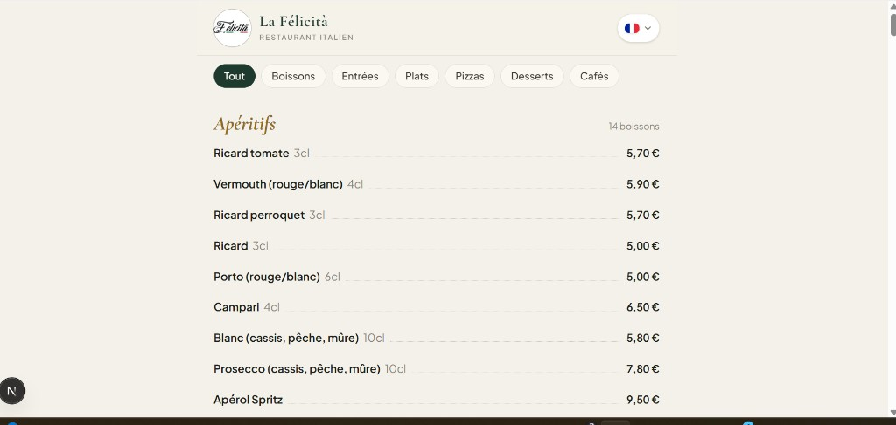
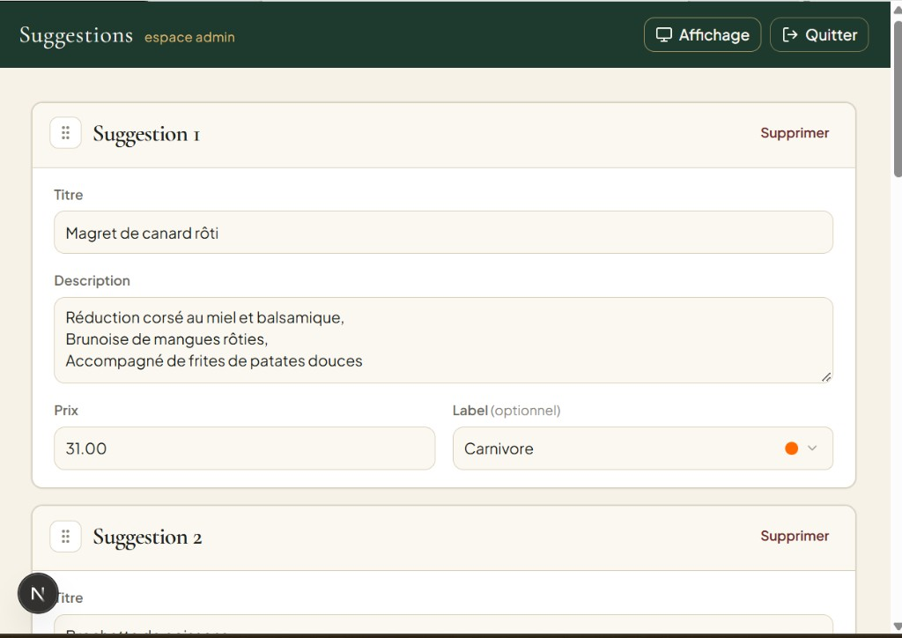
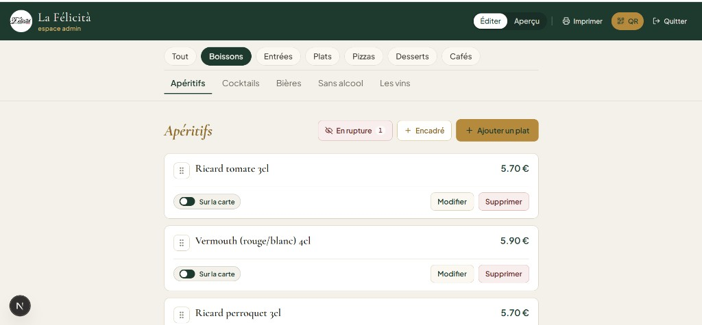

# Félicità — menu & suggestions du jour

Logiciel utilisé **en production** par le restaurant La Félicità (Furdenheim, 67).

Avant : menu imprimé, suggestions écrites à la main.  
Aujourd’hui : l’équipe met à jour depuis un téléphone. L’écran en salle et le menu QR se mettent à jour en même temps. La carte papier se régénère à l’impression.

## Ce que ça fait

| Qui | Quoi |
| --- | --- |
| Clients en salle | Tableau des suggestions (jusqu’à 8) + diaporama des **plats affichés** (photo facultative) |
| Clients | Menu digital par QR, **FR / EN / DE / IT**, langue mémorisée |
| Clients | Deux cartes : **sur place** et **à emporter** (vins, pictos, « en rupture ») |
| Équipe | Suggestions : ajout, photo (téléphone / galerie), ordre, activation (code PIN) |
| Gérant | Carte : catégories, plats, prix, encadrés, glisser-déposer, rupture, impression, QR (autre PIN) |

Les traductions du menu sont un **dictionnaire** (les plats déjà en carte). Un plat ajouté en back-office reste en français tant qu’on n’ajoute pas la traduction.

Les photos des suggestions sont des fichiers sur **Vercel Blob** ; Postgres ne garde que l’URL. Sans au moins deux photos sur le tableau, pas de diaporama.

## Stack

**Next.js 16** · React 19 · TypeScript · Tailwind CSS 4 · Prisma · PostgreSQL · Vercel Blob

Pages : `/display` (salle) · `/menu` (QR) · `/admin` (suggestions) · `/admin/menu` (gérant)

## Sécurité (résumé)

Deux PIN distincts (salle vs gérant). Session signée (HMAC), cookie `httpOnly`. Le PIN n’est pas stocké dans le navigateur.

## Auteur

**Hamid Bersi** — conception, développement, mise en production et suivi.
